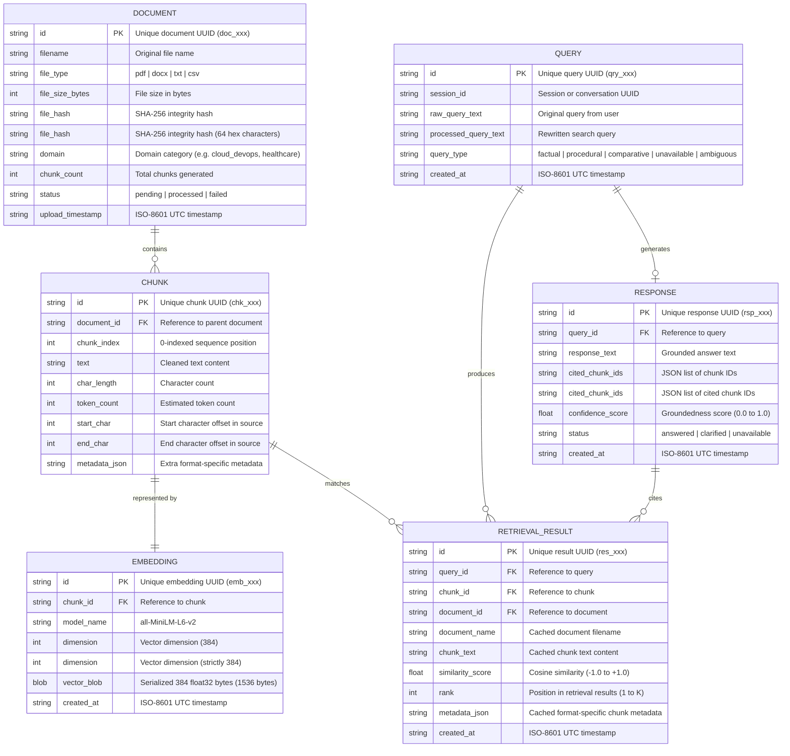

# M1.2 Data Models and Schemas Specification

**Project**: AI-Based Knowledge Retrieval Platform with Query Resolution System  
**Milestone**: 1 — System Architecture & Data Models  
**Status**: Architectural Specification  

---

## Table of Contents
1. [Overview of Data Architecture](#1-overview-of-data-architecture)
2. [Entity-Relationship Diagram](#2-entity-relationship-diagram)
3. [Core Data Models & Schemas](#3-core-data-models--schemas)
   - 3.1 Document Schema
   - 3.2 Chunk Schema
   - 3.3 Embedding Schema
   - 3.4 Query Schema
   - 3.5 Retrieval Result Schema
   - 3.6 Response Schema
4. [Field Validations, Constraints & Types](#4-field-validations-constraints--types)
   - 4.1 Cosine Similarity Score Range Specification
   - 4.2 Comprehensive Field Constraints Table
5. [Complete SQLite DDL Script (`schema.sql`)](#5-complete-sqlite-ddl-script-schemasql)

---

## 1. Overview of Data Architecture

The platform's data layer is designed around strong typing, relational consistency, and fast vector access:
- **Application Validation**: Implemented via **Pydantic v2** models, ensuring that incoming API requests, internal agent messages, and pipeline payloads conform to strict types and constraints.
- **Relational Persistence**: Managed in **SQLite 3**, providing zero-setup ACID compliance for metadata, text chunks, search queries, retrieval logs, and responses.
- **Vector Storage**: Chunk embeddings are stored as serialized binary floating-point arrays (`BLOB`) in SQLite and projected into an in-memory NumPy matrix for high-speed linear algebra search ($S = Q \cdot D^T$).

---

## 2. Entity-Relationship Diagram

The diagram below illustrates the relational cardinality among all six core entities in the platform. Each relationship is backed by explicit foreign-key references defined in the Pydantic models and SQLite schema.



---

## 3. Core Data Models & Schemas

### 3.1 Document Schema

#### Purpose
Tracks uploaded source files, their metadata, structural statistics, processing state, and domain categorization.

#### Field Specifications
- `id` (str, required): Unique document identifier with prefix `doc_` (e.g., `doc_9f82d1`).
- `filename` (str, required): Original filename with extension ($1 \le \text{length} \le 255$).
- `file_type` (FileType enum, required): File format (`pdf`, `docx`, `txt`, `csv`).
- `file_size_bytes` (int, required): File size in bytes ($\ge 1$).
- `file_hash` (str, required): 64-character hexadecimal SHA-256 integrity hash.
- `file_hash` (str, required): Strictly 64-character hexadecimal SHA-256 integrity hash matching regex `^[a-fA-F0-9]{64}$`.
- `domain` (str, optional, default="general"): Knowledge domain (e.g., `cloud_devops`, `healthcare`).
- `chunk_count` (int, optional, default=0): Total chunks generated from this document ($\ge 0$).
- `status` (DocumentStatus enum, optional, default="pending"): Lifecycle state (`pending`, `processed`, `failed`).
- `upload_timestamp` (datetime, optional, default=now UTC): Timestamp when file was uploaded.

#### Pydantic Model (Python)
```python
from enum import Enum
from datetime import datetime, timezone
from typing import Optional
from pydantic import BaseModel, Field

class FileType(str, Enum):
    PDF = "pdf"
    DOCX = "docx"
    TXT = "txt"
    CSV = "csv"

class DocumentStatus(str, Enum):
    PENDING = "pending"
    PROCESSED = "processed"
    FAILED = "failed"

class Document(BaseModel):
    id: str = Field(..., description="Unique document ID (e.g. doc_9f82d1)")
    filename: str = Field(..., min_length=1, max_length=255, description="Original filename with extension")
    file_type: FileType = Field(..., description="Document format type")
    file_size_bytes: int = Field(..., ge=1, description="Size of the uploaded file in bytes")
    file_hash: str = Field(..., min_length=64, max_length=64, description="SHA-256 cryptographic checksum")
    file_hash: str = Field(..., pattern=r"^[a-fA-F0-9]{64}$", description="SHA-256 cryptographic checksum (strictly 64 hex characters)")
    domain: str = Field(default="general", description="Domain classification (e.g. cloud_devops, healthcare)")
    chunk_count: int = Field(default=0, ge=0, description="Total number of chunks produced")
    status: DocumentStatus = Field(default=DocumentStatus.PENDING, description="Current ingestion lifecycle state")
    upload_timestamp: datetime = Field(default_factory=lambda: datetime.now(timezone.utc), description="Upload timestamp in UTC")
```

#### JSON Representation

> [!NOTE]
> **Illustrative Hash Note**: The `file_hash` below is an illustrative 64-character hexadecimal string representing a 1 MB DOCX file. In production, this field strictly contains the actual computed SHA-256 hash of the uploaded file's binary contents.

```json
{
  "id": "doc_9f82d1",
  "filename": "kubernetes_sdr_runbook.docx",
  "file_type": "docx",
  "file_size_bytes": 1048576,
  "file_hash": "a1b2c3d4e5f67890123456789abcdef0123456789abcdef0123456789abcdef0",
  "domain": "cloud_devops",
  "chunk_count": 14,
  "status": "processed",
  "upload_timestamp": "2026-11-15T00:50:00Z"
}
```

---

### 3.2 Chunk Schema

#### Purpose
Represents an individual textual unit resulting from document segmentation, storing text, positional indices, and format-specific metadata.

#### Field Specifications
- `id` (str, required): Unique chunk identifier with prefix `chk_` (e.g., `chk_5a6b7c`).
- `document_id` (str, required): Foreign key reference to parent `Document.id`.
- `chunk_index` (int, required): 0-based sequential position of the chunk in the source document ($\ge 0$).
- `text` (str, required): Cleaned, normalized text snippet ($\text{length} \ge 1$).
- `char_length` (int, required): Character length of the chunk text ($\ge 1$), must equal `end_char - start_char`.
- `char_length` (int, required): Character length of the chunk text ($\ge 1$), must equal `end_char - start_char` and `len(text)`.
- `token_count` (int, required): Estimated token count ($\ge 1$).
- `start_char` (int, required): Start character offset in the cleaned document text ($\ge 0$).
- `end_char` (int, required): End character offset in the cleaned document text ($> \text{start\_char}$).
- `metadata` (Dict[str, Any], optional, default={}): Format-specific metadata (page number, section heading, row index).

#### Pydantic Model (Python)
```python
from pydantic import BaseModel, Field, model_validator
from typing import Dict, Any

class Chunk(BaseModel):
    id: str = Field(..., description="Unique chunk ID (e.g. chk_5a6b7c)")
    document_id: str = Field(..., description="Foreign key reference to parent document")
    chunk_index: int = Field(..., ge=0, description="Sequential 0-based position in document")
    text: str = Field(..., min_length=1, description="Cleaned, normalized text snippet")
    char_length: int = Field(..., ge=1, description="Total character count in chunk")
    token_count: int = Field(..., ge=1, description="Estimated token count (approx. words * 1.3)")
    start_char: int = Field(..., ge=0, description="Starting character offset in raw text")
    end_char: int = Field(..., ge=1, description="Ending character offset in raw text")
    metadata: Dict[str, Any] = Field(default_factory=dict, description="Format metadata (e.g. page_number, row_index)")

    @model_validator(mode="after")
    def validate_offsets(self) -> "Chunk":
        if self.end_char <= self.start_char:
            raise ValueError("end_char must be strictly greater than start_char")
        if self.char_length != (self.end_char - self.start_char):
            raise ValueError("char_length must equal (end_char - start_char)")
        if self.char_length != len(self.text):
            raise ValueError("char_length must equal len(text)")
        return self
```

#### JSON Representation
```json
{
  "id": "chk_5a6b7c",
  "document_id": "doc_9f82d1",
  "chunk_index": 2,
  "text": "To verify cluster ingress health, execute 'kubectl get ingress -A'. Inspect the ADDRESS column to confirm load balancer IP assignment.",
  "char_length": 137,
  "token_count": 28,
  "start_char": 450,
  "end_char": 587,
  "metadata": {
    "page_number": 3,
    "section": "Ingress Controller Diagnostics"
  }
}
```

---

### 3.3 Embedding Schema

#### Purpose
Stores the dense numerical vector representation generated from a chunk, enabling persistent serialization and in-memory reconstruction.

#### Field Specifications
- `id` (str, required): Unique embedding identifier with prefix `emb_` (e.g., `emb_1a2b3c`).
- `chunk_id` (str, required): Unique foreign key reference to parent `Chunk.id`.
- `model_name` (str, optional, default="all-MiniLM-L6-v2"): Name of the embedding transformer model.
- `dimension` (int, optional, default=384): Dimensionality of the vector space, strictly 384 for `all-MiniLM-L6-v2`.
- `dimension` (Literal[384], required, default=384): Strictly 384 dimensions enforced via type literal.
- `vector` (List[float], required): Dense vector array containing exactly 384 floating-point coordinates.
- `created_at` (datetime, optional, default=now UTC): Timestamp when embedding was generated.

#### Pydantic Model (Python)
```python
from pydantic import BaseModel, Field
from typing import List
from typing import List, Literal
from datetime import datetime, timezone

class Embedding(BaseModel):
    id: str = Field(..., description="Unique embedding ID (e.g. emb_1a2b3c)")
    chunk_id: str = Field(..., description="Foreign key reference to chunk")
    model_name: str = Field(default="all-MiniLM-L6-v2", description="Transformer model used")
    dimension: int = Field(default=384, description="Vector dimension count (strictly 384 for MiniLM)")
    dimension: Literal[384] = Field(default=384, description="Vector dimension count (strictly 384 for MiniLM)")
    vector: List[float] = Field(..., min_length=384, max_length=384, description="Exact 384-dimensional dense float vector")
    created_at: datetime = Field(default_factory=lambda: datetime.now(timezone.utc), description="Generation timestamp in UTC")
```

#### JSON Representation

> [!NOTE]
> **Shortened Illustrative Example**: The `vector` array below displays 5 representative float values to illustrate JSON syntax without bloating documentation. In the production application and SQLite database, the vector strictly contains an array of exactly **384 float values** (`min_length=384, max_length=384`). A 5-element array would be rejected by schema validation.
> [!WARNING]
> **Non-Valid Illustrative Preview**: The `vector` array below displays 5 representative float values to illustrate JSON syntax without bloating documentation. In the production application and SQLite database, the vector strictly contains an array of exactly **384 float values** (`min_length=384, max_length=384`). This abbreviated snippet is not valid against the complete schema.

```json
{
  "id": "emb_1a2b3c",
  "chunk_id": "chk_5a6b7c",
  "model_name": "all-MiniLM-L6-v2",
  "dimension": 384,
  "vector": [
    -0.04124982,
    0.08912341,
    -0.01248912,
    0.05431298,
    0.0118492
  ],
  "created_at": "2026-11-15T00:50:02Z"
}
```

---

### 3.4 Query Schema

#### Purpose
Captures user search requests, intent classification, processed search phrases, and session associations.

#### Field Specifications
- `id` (str, required): Unique query identifier with prefix `qry_` (e.g., `qry_3c4d5e`).
- `session_id` (str, required): Session identifier for multi-turn tracking.
- `raw_query_text` (str, required): Raw text entered by the user ($1 \le \text{length} \le 1000$).
- `processed_query_text` (str, optional): Rewritten search query produced by Query Understanding Agent.
- `query_type` (QueryType enum, optional, default="factual"): Intent classification (`factual`, `procedural`, `comparative`, `unavailable`, `ambiguous`).
- `created_at` (datetime, optional, default=now UTC): Timestamp when query was submitted.

#### Pydantic Model (Python)
```python
from enum import Enum
from pydantic import BaseModel, Field
from datetime import datetime, timezone
from typing import Optional

class QueryType(str, Enum):
    FACTUAL = "factual"
    PROCEDURAL = "procedural"
    COMPARATIVE = "comparative"
    UNAVAILABLE = "unavailable"
    AMBIGUOUS = "ambiguous"

class Query(BaseModel):
    id: str = Field(..., description="Unique query ID (e.g. qry_3c4d5e)")
    session_id: str = Field(..., description="Session identifier for multi-turn tracking")
    raw_query_text: str = Field(..., min_length=1, max_length=1000, description="Raw query entered by user")
    processed_query_text: Optional[str] = Field(None, description="Rewritten search query from Query Understanding Agent")
    query_type: QueryType = Field(default=QueryType.FACTUAL, description="Classified query taxonomy")
    created_at: datetime = Field(default_factory=lambda: datetime.now(timezone.utc), description="Submission timestamp in UTC")
```

#### JSON Representation
```json
{
  "id": "qry_3c4d5e",
  "session_id": "sess_8912",
  "raw_query_text": "How do I check ingress health?",
  "processed_query_text": "Procedure for inspecting Kubernetes ingress controller health and load balancer IP assignment",
  "query_type": "procedural",
  "created_at": "2026-11-15T00:50:10Z"
}
```

---

### 3.5 Retrieval Result Schema

#### Purpose
Encapsulates a ranked match between a user query and a stored chunk, including similarity score, source attribution, and display content.

#### Field Specifications
- `id` (str, required): Unique retrieval result identifier with prefix `res_` (e.g., `res_7e8f9a`).
- `query_id` (str, required): Foreign key reference to parent `Query.id`.
- `chunk_id` (str, required): Foreign key reference to matched `Chunk.id`.
- `document_id` (str, required): Foreign key reference to matched `Document.id`.
- `document_name` (str, required): Filename of source document for user citation display.
- `chunk_text` (str, required): Text snippet of matched chunk.
- `similarity_score` (float, required): Cosine similarity score in mathematical interval $[-1.0, +1.0]$.
- `rank` (int, required): Rank position among returned results ($\ge 1$).
- `metadata` (Dict[str, Any], optional, default={}): Cached chunk positional metadata (page, section).
- `metadata` (Dict[str, Any], optional, default={}): Cached chunk positional metadata (page, section). Maps to `metadata_json` in SQLite.
- `created_at` (datetime, optional, default=now UTC): Timestamp when retrieval result was produced.

#### Pydantic Model (Python)
```python
from pydantic import BaseModel, Field
from typing import Dict, Any
from datetime import datetime, timezone

class RetrievalResult(BaseModel):
    id: str = Field(..., description="Unique retrieval result ID (e.g. res_7e8f9a)")
    query_id: str = Field(..., description="Reference to parent query")
    chunk_id: str = Field(..., description="Reference to matched chunk")
    document_id: str = Field(..., description="Reference to matched source document")
    document_name: str = Field(..., description="Filename of source document for user display")
    chunk_text: str = Field(..., description="Full text snippet of matched chunk")
    similarity_score: float = Field(..., ge=-1.0, le=1.0, description="Cosine similarity score in full mathematical interval (-1.0 to +1.0)")
    rank: int = Field(..., ge=1, description="Rank position (1 = highest relevance)")
    metadata: Dict[str, Any] = Field(default_factory=dict, description="Chunk positional metadata (e.g. page, section)")
    metadata: Dict[str, Any] = Field(default_factory=dict, description="Cached chunk positional metadata (e.g. page, section)")
    created_at: datetime = Field(default_factory=lambda: datetime.now(timezone.utc), description="Generation timestamp in UTC")
```

#### JSON Representation
```json
{
  "id": "res_7e8f9a",
  "query_id": "qry_3c4d5e",
  "chunk_id": "chk_5a6b7c",
  "document_id": "doc_9f82d1",
  "document_name": "kubernetes_sdr_runbook.docx",
  "chunk_text": "To verify cluster ingress health, execute 'kubectl get ingress -A'. Inspect the ADDRESS column to confirm load balancer IP assignment.",
  "similarity_score": 0.842,
  "rank": 1,
  "metadata": {
    "page_number": 3,
    "section": "Ingress Controller Diagnostics"
  },
  "created_at": "2026-11-15T00:50:11Z"
}
```

---

### 3.6 Response Schema

#### Purpose
Captures the final generated answer (or clarification notice) delivered to the user, tracking grounding citations, confidence metrics, and resolution status.

#### Field Specifications
- `id` (str, required): Unique response identifier with prefix `rsp_` (e.g., `rsp_9a0b1c`).
- `query_id` (str, required): Unique foreign key reference to parent `Query.id`.
- `response_text` (str, required): Grounded answer or clarification message.
- `citations` (List[ResponseCitation], optional, default=[]): List of source citations backing assertions.
- `confidence_score` (float, required): Overall answer grounding confidence score ($0.0 \le \text{score} \le 1.0$).
- `status` (ResponseStatus enum, optional, default="answered"): Resolution outcome (`answered`, `clarified`, `unavailable`).
- `created_at` (datetime, optional, default=now UTC): Timestamp when response was generated.

#### Citation Serialization
In the Pydantic application layer, citations are structured as a typed list of `ResponseCitation` objects (`document_name`, `chunk_index`, `chunk_id`). When persisted to SQLite, this list is serialized into the `cited_chunk_ids` column as a JSON array of strings containing the unique chunk IDs (e.g., `["chk_5a6b7c"]`), enabling relational lookup while maintaining SQLite simplicity.

#### Pydantic Model (Python)
```python
from enum import Enum
from pydantic import BaseModel, Field
from typing import List, Optional
from datetime import datetime, timezone

class ResponseStatus(str, Enum):
    ANSWERED = "answered"
    CLARIFIED = "clarified"
    UNAVAILABLE = "unavailable"

class ResponseCitation(BaseModel):
    document_name: str
    chunk_index: int
    chunk_id: str

class Response(BaseModel):
    id: str = Field(..., description="Unique response ID (e.g. rsp_9a0b1c)")
    query_id: str = Field(..., description="Reference to parent query")
    response_text: str = Field(..., description="Grounded answer or clarification message")
    citations: List[ResponseCitation] = Field(default_factory=list, description="List of source citations backing assertions")
    confidence_score: float = Field(..., ge=0.0, le=1.0, description="Overall answer grounding confidence score")
    status: ResponseStatus = Field(default=ResponseStatus.ANSWERED, description="Resolution outcome")
    created_at: datetime = Field(default_factory=lambda: datetime.now(timezone.utc), description="Generation timestamp in UTC")
```

#### JSON Representation
```json
{
  "id": "rsp_9a0b1c",
  "query_id": "qry_3c4d5e",
  "response_text": "To check ingress health, run 'kubectl get ingress -A' and verify that an IP is populated in the ADDRESS column [Doc: kubernetes_sdr_runbook.docx, Chunk: 2].",
  "citations": [
    {
      "document_name": "kubernetes_sdr_runbook.docx",
      "chunk_index": 2,
      "chunk_id": "chk_5a6b7c"
    }
  ],
  "confidence_score": 0.94,
  "status": "answered",
  "created_at": "2026-11-15T00:50:12Z"
}
```

---

## 4. Field Validations, Constraints & Types

### 4.1 Cosine Similarity Score Range Specification
- **Mathematical Bound**: By definition, the cosine of the angle between two normalized vectors in $\mathbb{R}^n$ lies within the closed interval **$[-1.0, +1.0]$**, where $+1.0$ represents identical orientation, $0.0$ represents orthogonality (unrelated concepts), and $-1.0$ represents diametrically opposed vectors.
- **Empirical NLP Observations**: In natural language embeddings produced by `all-MiniLM-L6-v2`, vectors occupy a directional cone where similarity scores for relevant and partially relevant texts typically fall between $0.0$ and $1.0$. However, diametrically opposed or contradictory texts can yield negative cosine scores down to $-1.0$.
- **Unified Schema Enforcement**: To guarantee strict mathematical consistency and avoid edge-case schema validation errors, all system specifications enforce the full $[-1.0, +1.0]$ boundary:
  - **Entity-Relationship Diagram**: Documented as `Cosine similarity (-1.0 to +1.0)`.
  - **Pydantic Validation**: `Field(..., ge=-1.0, le=1.0)`.
  - **SQLite Database Constraint**: `CHECK(similarity_score >= -1.0 AND similarity_score <= 1.0)`.

### 4.2 Comprehensive Field Constraints Table

| Schema | Field | Type | Validation Rules & Constraints | Purpose |
| :--- | :--- | :--- | :--- | :--- |
| **Document** | `id` | `VARCHAR(64)` | Primary Key, prefix `doc_` | Unique document identifier |
| | `filename` | `VARCHAR(255)` | Not Null, $1 \le \text{length} \le 255$ | Display and file lookup |
| | `file_type` | `VARCHAR(10)` | Enum: `pdf`, `docx`, `txt`, `csv` | Extractor routing |
| | `file_size_bytes` | `INTEGER` | Greater than 0 | File size tracking & limits |
| | `file_hash` | `VARCHAR(64)` | SHA-256 (64 hex characters) | Duplicate upload detection |
| | `file_hash` | `VARCHAR(64)` | SHA-256 (strictly 64 hex characters) | Duplicate upload detection |
| | `domain` | `VARCHAR(50)` | Not Null, default `general` | Domain-based filtering |
| | `chunk_count` | `INTEGER` | $\ge 0$, updated post-ingestion | Ingestion completeness audit |
| | `status` | `VARCHAR(20)` | Enum: `pending`, `processed`, `failed` | Processing state indicator |
| | `upload_timestamp` | `TIMESTAMP` | Default `CURRENT_TIMESTAMP` | Ingestion timestamp |
| **Chunk** | `id` | `VARCHAR(64)` | Primary Key, prefix `chk_` | Unique chunk identifier |
| | `document_id` | `VARCHAR(64)` | Foreign Key $\rightarrow$ `documents(id)` | Parent document link |
| | `chunk_index` | `INTEGER` | $\ge 0$, sequential order | Positional reconstruction |
| | `text` | `TEXT` | Not Null, non-empty string | Text for retrieval & context |
| | `char_length` | `INTEGER` | Length of `text`, $\text{char\_length} = \text{end\_char} - \text{start\_char}$ | Granularity & integrity check |
| | `char_length` | `INTEGER` | Length of `text`, $\text{char\_length} = \text{end\_char} - \text{start\_char} = \text{len(text)}$ | Granularity & integrity check |
| | `token_count` | `INTEGER` | $\ge 1$, estimated token count | LLM context planning |
| | `start_char` | `INTEGER` | $\ge 0$, offset in document | Precise source highlighting |
| | `end_char` | `INTEGER` | $> \text{start\_char}$ | Precise source highlighting |
| | `metadata_json` | `TEXT` | Default `'{}'` | Format-specific metadata |
| **Embedding** | `id` | `VARCHAR(64)` | Primary Key, prefix `emb_` | Unique embedding identifier |
| | `chunk_id` | `VARCHAR(64)` | Foreign Key $\rightarrow$ `chunks(id)`, Unique | 1:1 chunk to embedding link |
| | `model_name` | `VARCHAR(100)` | Default `all-MiniLM-L6-v2` | Model provenance tracking |
| | `dimension` | `INTEGER` | Exactly 384 for MiniLM | Vector dimension verification |
| | `vector_blob` | `BLOB` | Exactly $384 \times 4 = 1536$ bytes | Fast binary storage of float32 |
| | `dimension` | `INTEGER` | Strictly 384 for MiniLM | Vector dimension verification |
| | `vector_blob` | `BLOB` | Strictly $384 \times 4 = 1536$ bytes | Fast binary storage of float32 |
| | `created_at` | `TIMESTAMP` | Default `CURRENT_TIMESTAMP` | Embedding generation timestamp |
| **Query** | `id` | `VARCHAR(64)` | Primary Key, prefix `qry_` | Unique query tracking |
| | `session_id` | `VARCHAR(64)` | Not Null | Multi-turn conversation grouping |
| | `raw_query_text` | `TEXT` | Not Null, $1 \le \text{length} \le 1000$ | Audit trail of raw user input |
| | `processed_query_text` | `TEXT` | Optional rewritten string | Optimized retrieval query |
| | `query_type` | `VARCHAR(20)` | Enum: `factual`, `procedural`, etc. | Evaluation categorization |
| | `created_at` | `TIMESTAMP` | Default `CURRENT_TIMESTAMP` | Query submission timestamp |
| **Retrieval Result**| `id` | `VARCHAR(64)` | Primary Key, prefix `res_` | Unique retrieval result identifier |
| | `query_id` | `VARCHAR(64)` | Foreign Key $\rightarrow$ `queries(id)` | Parent query link |
| | `chunk_id` | `VARCHAR(64)` | Foreign Key $\rightarrow$ `chunks(id)` | Matched chunk link |
| | `document_id` | `VARCHAR(64)` | Foreign Key $\rightarrow$ `documents(id)` | Matched document link |
| | `document_name` | `VARCHAR(255)` | Not Null | Filename for citations |
| | `chunk_text` | `TEXT` | Not Null | Cached text snippet |
| | `similarity_score`| `REAL` | Float between $-1.0$ and $+1.0$ | Cosine similarity ranking |
| | `rank` | `INTEGER` | Integer $\ge 1$ | Top-$K$ order ranking |
| | `metadata_json` | `TEXT` | Default `'{}'` | Cached format-specific metadata |
| | `created_at` | `TIMESTAMP` | Default `CURRENT_TIMESTAMP` | Result generation timestamp |
| **Response** | `id` | `VARCHAR(64)` | Primary Key, prefix `rsp_` | Unique response identifier |
| | `query_id` | `VARCHAR(64)` | Foreign Key $\rightarrow$ `queries(id)`, Unique | 1:1 query to response link |
| | `response_text` | `TEXT` | Not Null | Final answer or message |
| | `cited_chunk_ids`| `TEXT` | Default `'[]'` | JSON list of cited chunk IDs |
| | `confidence_score`| `REAL` | Float between $0.0$ and $1.0$ | Groundedness score |
| | `status` | `VARCHAR(20)` | Enum: `answered`, `clarified`, `unavailable` | Outcome categorization |
| | `created_at` | `TIMESTAMP` | Default `CURRENT_TIMESTAMP` | Response generation timestamp |

---

## 5. Complete SQLite DDL Script (`schema.sql`)

Below is the complete SQL DDL schema designed for initializing SQLite persistence.

### Vector Storage Representation
Each dense vector produced by `all-MiniLM-L6-v2` consists of exactly **384 float32 coordinates**. Stored as a binary BLOB in SQLite, each float32 coordinate occupies 4 bytes (IEEE 754 single-precision float):
$$\text{BLOB Byte Length} = 384 \times 4 \text{ bytes} = 1536 \text{ bytes}$$
This representation can be serialized and deserialized using Python's `numpy.ndarray.tobytes()` and `numpy.frombuffer(blob, dtype=np.float32)`.
This representation is enforced via SQLite `CHECK(length(vector_blob) = 1536)` and can be serialized and deserialized in Python using `numpy.ndarray.tobytes()` and `numpy.frombuffer(blob, dtype=np.float32)`.

```sql
-- ============================================================================
-- AI-Based Knowledge Retrieval Platform: Database DDL Schema
-- Database Engine: SQLite 3
-- Target Milestone: Milestone 1 & Beyond
-- ============================================================================

PRAGMA foreign_keys = ON;

-- 1. Documents Table
CREATE TABLE IF NOT EXISTS documents (
    id VARCHAR(64) PRIMARY KEY,
    filename VARCHAR(255) NOT NULL,
    file_type VARCHAR(10) NOT NULL CHECK(file_type IN ('pdf', 'docx', 'txt', 'csv')),
    file_size_bytes INTEGER NOT NULL CHECK(file_size_bytes > 0),
    file_hash VARCHAR(64) NOT NULL,
    file_hash VARCHAR(64) NOT NULL CHECK(length(file_hash) = 64),
    domain VARCHAR(50) NOT NULL DEFAULT 'general',
    chunk_count INTEGER NOT NULL DEFAULT 0 CHECK(chunk_count >= 0),
    status VARCHAR(20) NOT NULL DEFAULT 'pending' CHECK(status IN ('pending', 'processed', 'failed')),
    upload_timestamp TIMESTAMP NOT NULL DEFAULT CURRENT_TIMESTAMP
);

CREATE INDEX IF NOT EXISTS idx_documents_file_hash ON documents(file_hash);
CREATE INDEX IF NOT EXISTS idx_documents_domain ON documents(domain);

-- 2. Chunks Table
CREATE TABLE IF NOT EXISTS chunks (
    id VARCHAR(64) PRIMARY KEY,
    document_id VARCHAR(64) NOT NULL,
    chunk_index INTEGER NOT NULL CHECK(chunk_index >= 0),
    text TEXT NOT NULL,
    char_length INTEGER NOT NULL CHECK(char_length > 0),
    token_count INTEGER NOT NULL CHECK(token_count > 0),
    start_char INTEGER NOT NULL CHECK(start_char >= 0),
    end_char INTEGER NOT NULL CHECK(end_char > start_char),
    metadata_json TEXT DEFAULT '{}',
    CHECK(char_length = end_char - start_char),
    CHECK(char_length = length(text)),
    FOREIGN KEY (document_id) REFERENCES documents(id) ON DELETE CASCADE
);

CREATE INDEX IF NOT EXISTS idx_chunks_document_id ON chunks(document_id);
CREATE INDEX IF NOT EXISTS idx_chunks_chunk_index ON chunks(document_id, chunk_index);

-- 3. Embeddings Table
CREATE TABLE IF NOT EXISTS embeddings (
    id VARCHAR(64) PRIMARY KEY,
    chunk_id VARCHAR(64) NOT NULL UNIQUE,
    model_name VARCHAR(100) NOT NULL DEFAULT 'all-MiniLM-L6-v2',
    dimension INTEGER NOT NULL DEFAULT 384 CHECK(dimension = 384),
    vector_blob BLOB NOT NULL,
    vector_blob BLOB NOT NULL CHECK(length(vector_blob) = 1536),
    created_at TIMESTAMP NOT NULL DEFAULT CURRENT_TIMESTAMP,
    FOREIGN KEY (chunk_id) REFERENCES chunks(id) ON DELETE CASCADE
);

CREATE INDEX IF NOT EXISTS idx_embeddings_chunk_id ON embeddings(chunk_id);

-- 4. Queries Table
CREATE TABLE IF NOT EXISTS queries (
    id VARCHAR(64) PRIMARY KEY,
    session_id VARCHAR(64) NOT NULL,
    raw_query_text TEXT NOT NULL,
    processed_query_text TEXT,
    query_type VARCHAR(20) NOT NULL DEFAULT 'factual' CHECK(query_type IN ('factual', 'procedural', 'comparative', 'unavailable', 'ambiguous')),
    created_at TIMESTAMP NOT NULL DEFAULT CURRENT_TIMESTAMP
);

CREATE INDEX IF NOT EXISTS idx_queries_session_id ON queries(session_id);

-- 5. Retrieval Results Table
CREATE TABLE IF NOT EXISTS retrieval_results (
    id VARCHAR(64) PRIMARY KEY,
    query_id VARCHAR(64) NOT NULL,
    chunk_id VARCHAR(64) NOT NULL,
    document_id VARCHAR(64) NOT NULL,
    document_name VARCHAR(255) NOT NULL,
    chunk_text TEXT NOT NULL,
    similarity_score REAL NOT NULL CHECK(similarity_score >= -1.0 AND similarity_score <= 1.0),
    rank INTEGER NOT NULL CHECK(rank >= 1),
    metadata_json TEXT DEFAULT '{}',
    created_at TIMESTAMP NOT NULL DEFAULT CURRENT_TIMESTAMP,
    FOREIGN KEY (query_id) REFERENCES queries(id) ON DELETE CASCADE,
    FOREIGN KEY (chunk_id) REFERENCES chunks(id) ON DELETE CASCADE,
    FOREIGN KEY (document_id) REFERENCES documents(id) ON DELETE CASCADE
);

CREATE INDEX IF NOT EXISTS idx_retrieval_query_id ON retrieval_results(query_id);

-- 6. Responses Table
CREATE TABLE IF NOT EXISTS responses (
    id VARCHAR(64) PRIMARY KEY,
    query_id VARCHAR(64) NOT NULL UNIQUE,
    response_text TEXT NOT NULL,
    cited_chunk_ids TEXT DEFAULT '[]',
    confidence_score REAL NOT NULL CHECK(confidence_score >= 0.0 AND confidence_score <= 1.0),
    status VARCHAR(20) NOT NULL DEFAULT 'answered' CHECK(status IN ('answered', 'clarified', 'unavailable')),
    created_at TIMESTAMP NOT NULL DEFAULT CURRENT_TIMESTAMP,
    FOREIGN KEY (query_id) REFERENCES queries(id) ON DELETE CASCADE
);

CREATE INDEX IF NOT EXISTS idx_responses_query_id ON responses(query_id);
```
