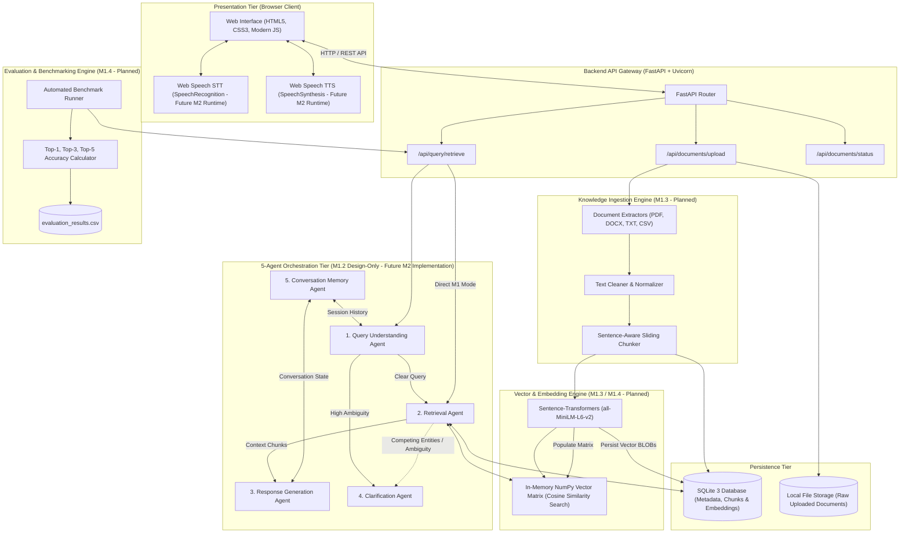
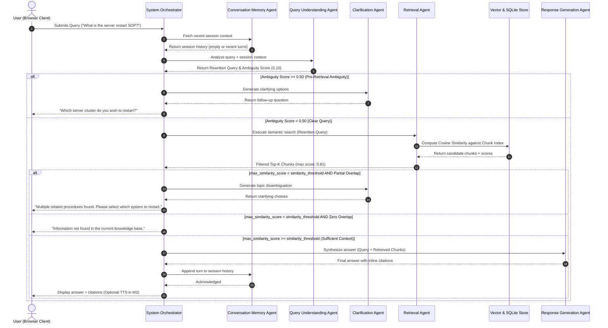
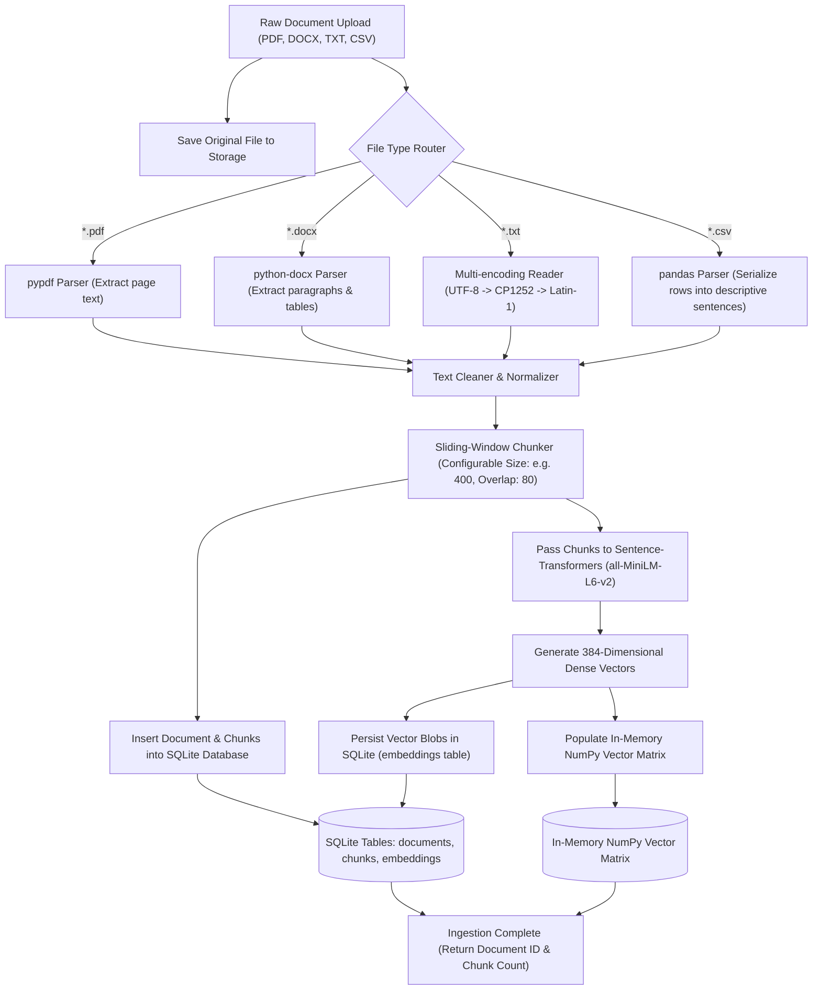
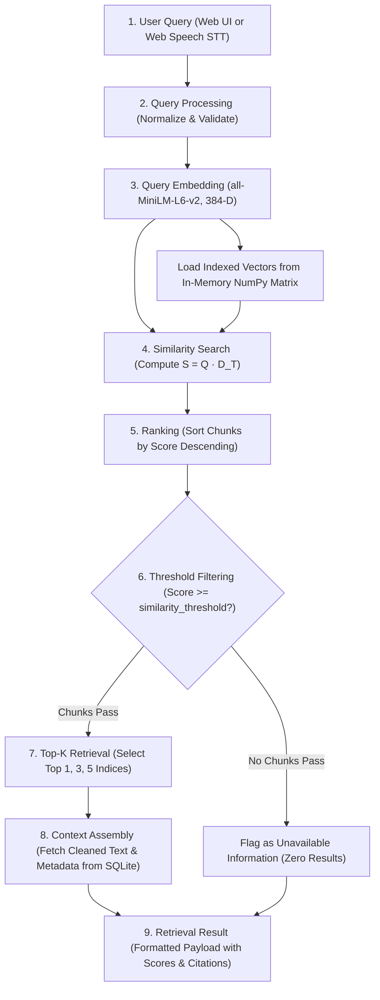

# M1.2 System Architecture Specification

**Project**: AI-Based Knowledge Retrieval Platform with Query Resolution System  
**Milestone**: 1 — System Architecture & Data Models  
**Status**: Architectural Design Specification  

---

## Table of Contents
1. [System Overview & Architectural Principles](#1-system-overview--architectural-principles)
2. [Overall System Architecture Diagram](#2-overall-system-architecture-diagram)
3. [Component Responsibilities](#3-component-responsibilities)
   - 3.1 Presentation Layer (Web UI & Web Speech API)
   - 3.2 API Gateway & Backend Services (FastAPI + Uvicorn)
   - 3.3 Knowledge Ingestion Engine (M1.3 – Planned)
   - 3.4 Embedding & Vector Search Engine (M1.3 / M1.4 – Planned)
   - 3.5 Persistence Layer (SQLite & Local File Store)
   - 3.6 Evaluation & Benchmark Engine (M1.4 – Planned)
4. [Five-Agent System Design (Architectural Specification)](#4-five-agent-system-design-architectural-specification)
   - 4.1 Query Understanding Agent (QUA)
   - 4.2 Retrieval Agent (RA)
   - 4.3 Response Generation Agent (RGA)
   - 4.4 Clarification Agent (CA)
   - 4.5 Conversation Memory Agent (CMA)
5. [Multi-Agent Orchestration & Information Flow](#5-multi-agent-orchestration--information-flow)
   - 5.1 Orchestration Logic & Conditional Routing
   - 5.2 Multi-Agent Execution Sequence Diagram
   - 5.3 Agent Communication Contracts
6. [End-to-End Data Flow Diagrams](#6-end-to-end-data-flow-diagrams)
   - 6.1 Document Ingestion Data Flow
   - 6.2 RAG Retrieval Data Flow
7. [Milestone 1 Implementation Boundaries vs Future Milestones](#7-milestone-1-implementation-boundaries-vs-future-milestones)

---

## 1. System Overview & Architectural Principles

The **AI-Based Knowledge Retrieval Platform with Query Resolution System** is an enterprise-grade, retrieval-augmented intelligence platform. Its proposed objective is to ingest heterogeneous corporate and technical documents (PDF, DOCX, TXT, CSV), construct semantic vector representations, and provide accurate, cited answers to complex user inquiries through multi-agent orchestration.

Within Milestone 1, M1.1 (Research), M1.2 (System Architecture and Data Models), M1.3 (Knowledge Base Ingestion), and M1.4 (Semantic Retrieval Pipeline & Benchmark) are implemented and empirically verified. The five agents, LLM answer generation, and voice runtime execution are thoroughly designed and specified here, while their programmatic implementation is deferred to Milestone 2.

### Core Architectural Principles

1. **Modularity & Loose Coupling**: Each architectural component (document ingestion, embedding generation, vector similarity search, persistence, and multi-agent coordination) is isolated behind clean interfaces. Components can be enhanced or replaced independently without breaking adjacent layers.
2. **Beginner-Friendly Transparency**: Rather than burying vector operations inside opaque remote cloud databases, vector calculations (NumPy dot-product Cosine Similarity) are directly observable, educational, and locally verifiable.
3. **Decoupled Agent Responsibilities**: Complex query resolution is partitioned into five specialized agents with strict message contracts, preventing prompt bloat and catastrophic forgetting.
4. **Verifiable Grounding & Citation**: Grounded prompt design and explicit source citations are fundamental architectural design goals and safeguards against ungrounded hallucinations, requiring that every asserted fact in downstream milestones is backed by traceable source chunks with calculated similarity scores and exact file attributions.
5. **Strict Milestone 1 Bounding**: Within Milestone 1, M1.1 through M1.4 are completed and tested. The five agents, LLM response generation, and voice runtime execution are thoroughly designed and specified here, while their runtime implementation is strictly reserved for Milestone 2.

---

## 2. Overall System Architecture Diagram

The diagram below illustrates the proposed end-to-end architecture across all tiers: presentation, API routing, processing engines, multi-agent orchestration, and persistent storage.



---

## 3. Component Responsibilities

The proposed system architecture is organized into six core functional components. Their responsibilities within the architecture are defined below, clearly distinguishing proposed designs from planned and future implementation tasks:

### 3.1 Presentation Layer (Web UI & Web Speech API)
- **Document Management Interface (Proposed Design)**: Designed to provide file selection and upload for PDF, DOCX, TXT, and CSV formats with ingestion status indicators.
- **Query Resolution Interface (Proposed Design)**: Designed to offer a clean search bar with real-time feedback, displaying retrieved chunks, similarity percentages, and source file metadata.
- **Voice Interface (Proposed Design — Future M2 Implementation)**:
  - `SpeechRecognition`: Designed to enable hands-free query dictation directly in modern browsers.
  - `SpeechSynthesis`: Designed to provide optional voice playback of platform responses.
- **Graceful Degradation (Proposed Design)**: Designed such that if browser microphone permissions are blocked or unsupported, the UI defaults seamlessly to standard keyboard input without throwing unhandled exceptions.

### 3.2 API Gateway & Backend Services (FastAPI + Uvicorn)
- **Routing & Endpoint Management (Proposed Design)**: Designed to dispatch client requests to the appropriate ingestion or retrieval handlers.
- **Pydantic Validation (Proposed Design)**: Designed to validate all incoming payloads and query parameters against strongly-typed schemas before execution.
- **Asynchronous Execution (Proposed Design)**: Designed to use Python `async` event loops to prevent long-running file parsing tasks from blocking retrieval queries.
- **Interactive Documentation (Proposed Design)**: Designed to auto-generate OpenAPI / Swagger interactive documentation at `/docs` for testing once endpoints are registered.

### 3.3 Knowledge Ingestion Engine (M1.3 – Planned)
- **Document Extractors (Planned Implementation)**:
  - `pypdf`: To extract raw text from binary PDF pages.
  - `python-docx`: To extract text from Word documents, preserving paragraph and table content.
  - `pandas`: To read CSV tables, serializing tabular records into descriptive semantic sentences.
  - Native Python file reader: To ingest plain text with a multi-encoding fallback order of `UTF-8` $\rightarrow$ `CP1252` $\rightarrow$ `Latin-1`. Latin-1 (ISO-8859-1) is placed as the final fallback because its byte map assigns a valid character to every byte value from `0x00` to `0xFF`; placing Latin-1 earlier would cause it to decode almost any byte sequence without throwing a `UnicodeDecodeError`, preventing detection of Windows-1252 (CP1252) specific characters (such as smart quotes and en-dashes).
- **Text Cleaner & Normalizer (Planned Implementation)**: Designed to strip non-printable control characters, normalize Unicode accents, collapse redundant whitespace, and clean broken hyphens.
- **Sliding-Window Chunker (Planned Implementation)**: Designed to segment cleaned text into chunks using a proposed configurable default chunk size of 400 characters (within a configurable range of 300 to 500 characters) and a proposed configurable default overlap of 80 characters (within a configurable range of 50 to 100 characters) to ensure conceptual continuity across segment boundaries. These default values serve as initial design baselines to be evaluated in M1.3.

### 3.4 Embedding & Vector Search Engine (M1.3 / M1.4 – Planned)
- **Dense Embedder (Planned Implementation)**: Designed to convert cleaned text chunks into 384-dimensional dense vectors using the local `all-MiniLM-L6-v2` transformer model.
- **Dual Vector Storage & Search (Planned Implementation)**:
  - **Persistent Relational Storage**: Serializes 384-dimensional vectors as 1536-byte binary BLOBs in the SQLite `embeddings` table for durable persistence.
  - **In-Memory Search Matrix**: Projects active vectors into an in-memory 2D NumPy array for high-speed linear algebra search ($S = Q \cdot D^T$).
- **Similarity Search (Planned Implementation)**: Designed to execute matrix dot-product multiplication against query vectors to compute exact Cosine Similarity.
- **Relevance Filtering (Planned Implementation)**: Designed to apply a configurable similarity threshold (`similarity_threshold`) to filter out irrelevant or out-of-domain queries.

### 3.5 Persistence Layer (SQLite & Local File Store)
- **Local File Store (Proposed Design)**: Designed to retain original uploaded files in structured folders (`sample_documents/` or `uploads/`) for auditability and raw file inspection.
- **SQLite 3 Database (Proposed Design)**: Designed to persist relational data models:
  - Document records (filename, file type, file size, upload timestamp, chunk count).
  - Chunk records (chunk ID, document foreign key, chunk index, cleaned and normalized text content, character count).
  - Embedding records (embedding ID, chunk foreign key, model name, dimension, binary vector BLOB).
  - Query records and retrieval audit logs.

### 3.6 Evaluation & Benchmark Engine (M1.4 – Planned)
- **Ground-Truth Dataset (Planned Implementation)**: Designed to manage test suites categorized across Factual, Procedural, Comparative, and Unavailable information queries.
- **Automated Runner (Planned Implementation)**: Designed to execute benchmark queries against the retrieval engine.
- **Metric Computation (Planned Implementation)**: Designed to calculate Top-1, Top-3, and Top-5 retrieval accuracy percentages, logging raw scores to `evaluation/evaluation_results.csv`.

---

## 4. Five-Agent System Design (Architectural Specification)

In complex query resolution, asking a single model to parse intent, search vector databases, detect ambiguities, track multi-turn memory, and write answers causes confusion and hallucinations. The proposed platform partitions these responsibilities into **five specialized agents**.

> [!NOTE]
> In Milestone 1, these five agents are **design specifications only**. They are not programmatically implemented or running in Milestone 1. Their programmatic LLM execution logic is scheduled for implementation in Milestone 2.

```
+─────────────────────────────────────────────────────────────────────────────+
|                         THE 5 SPECIALIZED AGENTS                            |
+─────────────────────────────────────────────────────────────────────────────+
| 1. Query Understanding Agent  ──► Intent, entities, query rewrite/expansion |
| 2. Retrieval Agent            ──► Semantic search, thresholding, re-ranking |
| 3. Response Generation Agent  ──► Grounded answer synthesis with citations  |
| 4. Clarification Agent        ──► Ambiguity detection, follow-up questions  |
| 5. Conversation Memory Agent  ──► Multi-turn session context & history      |
+─────────────────────────────────────────────────────────────────────────────+
```

---

### 4.1 Query Understanding Agent (QUA)

- **Purpose**: Acts as the analytical front door of the query resolution pipeline, interpreting user intent and structuring queries for downstream retrieval.
- **Responsibilities**:
  - Classify query intent into standard categories (`FACTUAL`, `PROCEDURAL`, `COMPARATIVE`, `AMBIGUOUS`).
  - Extract domain entities (technical terms, system names, error codes, version numbers).
  - Rewrite and expand raw user queries into search-optimized phrasing.
  - Compute an ambiguity score ($0.0$ to $1.0$) to determine if clarification is required before retrieval.
- **Expected Input**:
  - `raw_query`: Raw query string submitted by the user.
  - `session_history`: Prior conversation turns from the Conversation Memory Agent.
- **Expected Output**:
  - `intent`: Intent classification string.
  - `entities`: List of extracted entity strings.
  - `rewritten_query`: Expanded search query string.
  - `ambiguity_score`: Float between $0.0$ and $1.0$.
  - `requires_clarification`: Boolean flag (`true` if ambiguity $\ge 0.50$).
- **Interaction with Other Agents**:
  - Receives prior context from Conversation Memory Agent.
  - Passes rewritten query to Retrieval Agent if query is clear (`ambiguity_score < 0.50`).
  - Routes query to Clarification Agent if ambiguous (`ambiguity_score >= 0.50`).
- **Position in the Proposed Workflow**: First reasoning step in the query resolution sequence following session context retrieval.

#### Input / Output Contract
> [!NOTE]
> **Illustrative Synthetic Example**: The JSON payload below is an illustrative, synthetic design contract specified for architectural planning. Values and metrics are design examples, not measured or runtime results.

```json
{
  "agent": "QueryUnderstandingAgent",
  "input": {
    "raw_query": "What are the server restart steps after power outage?",
    "session_history": []
  },
  "output": {
    "intent": "PROCEDURAL",
    "entities": [
      "server",
      "restart steps",
      "power outage"
    ],
    "rewritten_query": "Standard operating procedure for server restart sequence following a power outage",
    "ambiguity_score": 0.1,
    "requires_clarification": false
  }
}
```

---

### 4.2 Retrieval Agent (RA)

- **Purpose**: Knowledge-gathering coordinator that queries indexed document vectors and retrieves the most semantically relevant text chunks.
- **Responsibilities**:
  - Generate query embeddings using `all-MiniLM-L6-v2`.
  - Calculate cosine similarity scores against indexed chunk vectors.
  - Apply configurable similarity threshold filtering (`similarity_threshold`, with a proposed initial baseline of `0.35` to be evaluated during M1.4) to eliminate irrelevant context.
  - Rank chunks in descending order and select Top-$K$ (e.g. $K=3$ or $5$).
  - Fetch cleaned chunk text and metadata from the SQLite persistence store.
  - Deduplicate adjacent overlapping sliding-window chunks.
  - Evaluate retrieval context: if `max_similarity_score < similarity_threshold`, flag `has_sufficient_context = false`.
- **Expected Input**:
  - `search_query`: Rewritten query string from Query Understanding Agent.
  - `top_k`: Integer number of chunks to return (default: 3 to 5).
  - `similarity_threshold`: Float minimum score cutoff (configurable variable; proposed initial baseline: 0.35).
- **Expected Output**:
  - `chunks_retrieved`: List of matched chunk objects with IDs, document names, text snippets, and similarity scores.
  - `max_similarity_score`: Highest cosine similarity score achieved.
  - `has_sufficient_context`: Boolean indicating if relevant information was found.
- **Interaction with Other Agents**:
  - Receives search query from Query Understanding Agent (or direct API call in Milestone 1 testing mode).
  - Queries the Vector & Persistence Tier.
  - Passes retrieved chunks to Response Generation Agent if `has_sufficient_context` is true (`max_similarity_score >= similarity_threshold`).
  - If `max_similarity_score < similarity_threshold`:
    - If partial topic overlap or multiple competing candidate entities are detected, routes to Clarification Agent for user disambiguation.
    - If zero meaningful overlap is detected, returns an "Information Unavailable" message directly to the client.
- **Position in the Proposed Workflow**: Sits between Query Understanding and Response Generation / Clarification.

#### Input / Output Contract
> [!NOTE]
> **Illustrative Synthetic Example**: The JSON payload below is an illustrative, synthetic design contract specified for architectural planning. Values and metrics are design examples, not measured or runtime results.

```json
{
  "agent": "RetrievalAgent",
  "input": {
    "search_query": "Standard operating procedure for server restart sequence following a power outage",
    "top_k": 3,
    "similarity_threshold": 0.35
  },
  "output": {
    "chunks_retrieved": [
      {
        "chunk_id": "chk_8941",
        "document_name": "datacenter_sdr_manual.docx",
        "chunk_index": 4,
        "similarity_score": 0.812,
        "text": "In the event of an unplanned power interruption, datacenter operators must first verify that auxiliary generator power is stabilized before cycling master rack switches. Once auxiliary power is confirmed steady, operators should engage the master power switch for Rack Group Alpha."
      }
    ],
    "max_similarity_score": 0.812,
    "has_sufficient_context": true
  }
}
```

---

### 4.3 Response Generation Agent (RGA)

- **Purpose**: Synthesizes retrieved document passages into fluent, factual answers with explicit citations, incorporating strict context constraints and citation rules as safeguards to substantially reduce unsupported or hallucinated responses.
- **Responsibilities**:
  - Formulate structured prompt context injecting retrieved chunks and user query.
  - Generate grounded natural language responses strictly constrained to provided chunks, minimizing ungrounded responses by restricting assertions to supplied passages.
  - Generate unambiguous source citations mapped to source document filenames and chunk indices (`[Doc: <name>, Chunk: <index>]`).
  - Calculate grounding confidence score ($0.0$ to $1.0$).
  - Refuse to answer if context is contradictory or insufficient.
- **Expected Input**:
  - `user_query`: Original or clarified user question.
  - `retrieved_context`: List of candidate chunks with chunk IDs, document names, chunk indices, and text.
- **Expected Output**:
  - `response_text`: Grounded markdown response with inline citations strictly based on provided context.
  - `citations`: List of structured citation objects (`document_name`, `chunk_index`, `chunk_id`).
  - `grounding_confidence`: Float between $0.0$ and $1.0$.
- **Interaction with Other Agents**:
  - Receives context chunks from Retrieval Agent.
  - Emits grounded response to Conversation Memory Agent (for logging) and to API Gateway for user presentation.
- **Position in the Proposed Workflow**: Final synthesis step before updating conversation history and returning answer to client.

#### Input / Output Contract
> [!NOTE]
> **Illustrative Synthetic Example**: The JSON payload below is an illustrative, synthetic design contract specified for architectural planning. Values and metrics are design examples, not measured or runtime results. The response contains only assertions substantiated by the supplied context chunk.

```json
{
  "agent": "ResponseGenerationAgent",
  "input": {
    "user_query": "What are the server restart steps after power outage?",
    "retrieved_context": [
      {
        "chunk_id": "chk_8941",
        "document_name": "datacenter_sdr_manual.docx",
        "chunk_index": 4,
        "text": "In the event of an unplanned power interruption, datacenter operators must first verify that auxiliary generator power is stabilized before cycling master rack switches. Once auxiliary power is confirmed steady, operators should engage the master power switch for Rack Group Alpha."
      }
    ]
  },
  "output": {
    "response_text": "Following an unplanned power interruption, operators must first verify that auxiliary generator power is stabilized before cycling master rack switches. Once auxiliary power is steady, operators should engage the master power switch for Rack Group Alpha [Doc: datacenter_sdr_manual.docx, Chunk: 4].",
    "citations": [
      {
        "document": "datacenter_sdr_manual.docx",
        "chunk_index": 4,
        "chunk_id": "chk_8941"
      }
    ],
    "grounding_confidence": 0.95
  }
}
```

---

### 4.4 Clarification Agent (CA)

- **Purpose**: Proactively engages the user when an inquiry is ambiguous, underspecified, or when retrieval reveals competing topics, formulating focused questions rather than making speculative assumptions.
- **Responsibilities**:
  - Detect ambiguity causes:
    1. Pre-retrieval query ambiguity (`ambiguity_score >= 0.50`).
    2. Post-retrieval topic overlap / competing candidate entities where scores are close to `similarity_threshold`.
  - Formulate clear, concise follow-up questions with suggested multiple-choice options.
  - Explicitly inform the user when requested information does not exist in the knowledge base.
- **Expected Input**:
  - `raw_query`: Original query text.
  - `ambiguity_reason`: Diagnostic description of why the query cannot be retrieved directly.
  - `candidate_entities`: Conflicting or candidate topics detected in the corpus.
- **Expected Output**:
  - `is_clarification_required`: Boolean flag (`true`).
  - `clarification_message`: Focused follow-up prompt for user.
  - `suggested_options`: Array of selectable clarifying options.
- **Interaction with Other Agents**:
  - Invoked by Query Understanding Agent when `ambiguity_score >= 0.50`.
  - Invoked by Retrieval Agent when candidate scores fall slightly below `similarity_threshold` with multiple conflicting topic matches.
  - Delivers prompt to user, whose reply feeds back into Conversation Memory Agent and Query Understanding Agent.
- **Position in the Proposed Workflow**: Alternative branch taken instead of Retrieval or Response Generation when query input or retrieval results are underspecified.

#### Input / Output Contract
> [!NOTE]
> **Illustrative Synthetic Example**: The JSON payload below is an illustrative, synthetic design contract specified for architectural planning. Values and metrics are design examples, not measured or runtime results.

```json
{
  "agent": "ClarificationAgent",
  "input": {
    "raw_query": "How do I upgrade the database?",
    "ambiguity_reason": "Multiple databases detected in knowledge base: PostgreSQL v15 and SQLite 3.",
    "candidate_entities": [
      "PostgreSQL",
      "SQLite"
    ]
  },
  "output": {
    "is_clarification_required": true,
    "clarification_message": "Our documentation contains upgrade procedures for multiple database systems. Which database would you like to upgrade?",
    "suggested_options": [
      "PostgreSQL Production Cluster",
      "SQLite Local Application Cache"
    ]
  }
}
```

---

### 4.5 Conversation Memory Agent (CMA)

- **Purpose**: Maintains dialogue history across multi-turn user sessions, providing context resolution for follow-up questions and pronoun references.
- **Responsibilities**:
  - Track session IDs and maintain chronological dialogue turns.
  - Store query-response pairs, retrieved chunk references, and user selections.
  - Provide a sliding window of recent conversation turns (e.g. last 5-10 turns).
  - Distill older context to preserve token limits while maintaining coherence.
  - Reset session history upon explicit user request.
- **Expected Input**:
  - `session_id`: Unique identifier for the conversation session.
  - `action`: Operation to perform (`GET_CONTEXT`, `APPEND_TURN`, `CLEAR_SESSION`).
  - `turn_data`: User query and assistant response payload (for `APPEND_TURN`).
  - `turn_limit`: Number of recent turns to return (for `GET_CONTEXT`).
- **Expected Output**:
  - `session_id`: Unique session identifier.
  - `history`: Array of past conversation turns with role, message, and metadata.
  - `active_entity_context`: Extracted active topics/entities from recent turns.
- **Interaction with Other Agents**:
  - Supplies context history to Query Understanding Agent at session start.
  - Receives finalized response from Response Generation Agent or Clarification Agent to append turn.
- **Position in the Proposed Workflow**: Envelops the entire lifecycle: consulted at query entry and updated at query completion.

#### Input / Output Contract
> [!NOTE]
> **Illustrative Synthetic Example**: The JSON payload below is an illustrative, synthetic design contract specified for architectural planning. Values and entities are neutral fictional examples, not compliance claims or measured results.

```json
{
  "agent": "ConversationMemoryAgent",
  "input": {
    "session_id": "sess_90214",
    "action": "GET_CONTEXT",
    "turn_limit": 3
  },
  "output": {
    "session_id": "sess_90214",
    "history": [
      {
        "turn": 1,
        "role": "user",
        "message": "What is the primary network interface for the web cluster?"
      },
      {
        "turn": 1,
        "role": "assistant",
        "message": "The primary network interface for the web cluster is eth0, configured with static IP allocation [Doc: network_topology.docx, Chunk: 2]."
      }
    ],
    "active_entity_context": "Web cluster network interface configuration"
  }
}
```

---

## 5. Multi-Agent Orchestration & Information Flow

> [!NOTE]
> The orchestration architecture documented below is a **proposed design specification for Milestone 2 implementation**. It is not operational in Milestone 1. In Milestone 1, search queries interface directly with the standalone semantic retrieval pipeline (M1.4).

### 5.1 Orchestration Logic & Conditional Routing

The coordination between the five agents follows a **Conditional Router Topology**. A central orchestrator evaluates intermediate metrics at each step, making deterministic routing decisions based on ambiguity and similarity thresholds:

```
[ User Input Received ]
          │
          ▼
[ Consult Conversation Memory Agent ] ──► Retrieve recent dialogue context
          │
          ▼
[ Invoke Query Understanding Agent ]
          │
          ├──► Ambiguity Score >= 0.50 ? ────► [ Invoke Clarification Agent ] ──► [ Prompt User ]
          │
          └──► Ambiguity Score < 0.50 (Clear Query)
                     │
                     ▼
        [ Invoke Retrieval Agent ]
                     │
                     ├──► Max Similarity Score < Similarity Threshold ?
                     │          │
                     │          ├──► Partial Overlap / Competing Entities ?
                     │          │          │
                     │          │          ▼
                     │          │   [ Invoke Clarification Agent ] ──► [ Prompt User with Disambiguation ]
                     │          │
                     │          └──► Zero / Negligible Overlap ?
                     │                     │
                     │                     ▼
                     │              [ Return "Unavailable Information" Message ]
                     │
                     └──► Max Similarity Score >= Similarity Threshold (Sufficient Context)
                                │
                                ▼
                 [ Invoke Response Generation Agent ]
                                │
                                ▼
                 [ Update Conversation Memory Agent ]
                                │
                                ▼
                 [ Deliver Final Grounded Answer ]
```

#### Routing Decision Criteria:
1. **Dialogue Context Resolution**: The orchestrator retrieves prior session state from the Conversation Memory Agent before analyzing a new user input.
2. **Pre-Retrieval Ambiguity Gate**:
   - `ambiguity_score >= 0.50`: The query is classified as underspecified, vague, or missing necessary context. The orchestrator diverts execution immediately to the **Clarification Agent**, prompting the user with targeted clarifying options.
   - `ambiguity_score < 0.50`: The query is classified as clear and actionable. The orchestrator routes the query directly to the **Retrieval Agent**.
3. **Post-Retrieval Relevance & Disambiguation Gate**:
   - The orchestrator compares the **maximum retrieved similarity score** (`max_similarity_score`) against the configurable `similarity_threshold`:
   - `max_similarity_score < similarity_threshold`:
     - *Case A (Partial Overlap / Competing Entities)*: Candidate chunks score near the threshold with partial semantic overlap across multiple distinct topics or systems. The orchestrator invokes the **Clarification Agent** to ask the user which specific topic or system they meant.
     - *Case B (Zero / Negligible Relevance)*: Chunks score well below the cutoff with no meaningful topic match. The orchestrator returns an **Unavailable Information** response directly, stating that the knowledge base lacks information on that topic.
   - `max_similarity_score >= similarity_threshold`: The retrieved passages provide sufficient relevant context. Execution proceeds to the **Response Generation Agent**.
   - *Baseline Threshold Note*: The threshold value `0.35` is a proposed initial baseline that will be empirically evaluated and calibrated during M1.4 testing across both test domains, rather than an experimentally established constant.
4. **Grounded Synthesis**: The Response Generation Agent synthesizes the final answer, strictly grounded in the retrieved passages with inline citations.
5. **State Commitment**: The final interaction turn (query, citations, answer) is committed back to the Conversation Memory Agent.

---

### 5.2 Multi-Agent Execution Sequence Diagram

The sequence diagram below shows the interaction lifecycles across the proposed multi-agent workflow.

> [!NOTE]
> This sequence diagram represents a **proposed Milestone 2 architecture**. Speech input and text-to-speech (TTS) playback belong to future Milestone 2 scope and are not executed in Milestone 1.



---

### 5.3 Agent Communication Contracts

To ensure interoperability across the proposed multi-agent architecture, agents communicate using structured JSON envelopes:

> [!NOTE]
> **Illustrative Synthetic Example**: The envelope below is an illustrative design contract specified for architectural planning.

```json
{
  "message_id": "msg_uuid4",
  "session_id": "sess_uuid4",
  "timestamp": "2026-11-15T00:50:00Z",
  "sender": "QueryUnderstandingAgent",
  "recipient": "RetrievalAgent",
  "payload": {
    "rewritten_query": "Standard operating procedure for server restart sequence following a power outage",
    "intent": "PROCEDURAL",
    "entities": [
      "server",
      "restart",
      "power outage"
    ],
    "confidence": 0.95
  }
}
```

---

## 6. End-to-End Data Flow Diagrams

### 6.1 Document Ingestion Data Flow

> [!NOTE]
> The document ingestion data flow described below is **planned for implementation in Milestone 1 (M1.3)**. It has not yet been implemented or tested.

The planned ingestion workflow transforms heterogeneous source files into cleaned, chunked, and embedded representations stored for vector search:

`Upload` $\rightarrow$ `File Validation` $\rightarrow$ `Text Extraction` $\rightarrow$ `Cleaning` $\rightarrow$ `Chunking` $\rightarrow$ `Embedding Generation` $\rightarrow$ `Vector Storage and Metadata Storage`



#### Detailed Stage Breakdown:
1. **Upload**: The user uploads a source file (PDF, DOCX, TXT, or CSV) through the web interface or via the `/api/documents/upload` REST endpoint.
2. **File Validation**: The API verifies the file extension, checks that file size is within acceptable bounds ($1 \text{ byte} \le \text{size} \le 10 \text{ MB}$, a proposed configurable default limit for testing), and calculates the SHA-256 cryptographic hash to detect duplicate uploads.
3. **Text Extraction**: The file type router directs the document to the corresponding extractor:
   - `pypdf` extracts text across pages for PDF files.
   - `python-docx` extracts body paragraphs and table cells for DOCX files.
   - Multi-encoding reader ingests plain text files with a fallback order of `UTF-8` $\rightarrow$ `CP1252` $\rightarrow$ `Latin-1`. Latin-1 is placed as the final fallback because it successfully maps any byte `0x00`-`0xFF` to a character, which would mask CP1252-specific characters if placed earlier.
   - `pandas` reads CSV tables and serializes row records into descriptive sentences.
4. **Cleaning**: The raw extracted text undergoes normalization: stripping non-printable ASCII/control characters, standardizing whitespace, repairing hyphenated word breaks, and normalizing Unicode.
5. **Chunking**: The cleaned text is segmented using a sentence-aware sliding window using a proposed configurable default chunk size of 400 characters (configurable range: 300 to 500 characters) and an overlap of 80 characters (configurable range: 50 to 100 characters) to maintain contextual coherence across segment boundaries.
6. **Embedding Generation**: Each text chunk is passed to the local `all-MiniLM-L6-v2` Sentence-Transformer model to produce a 384-dimensional dense float32 vector.
7. **Vector Storage and Metadata Storage**:
   - **Persistent Storage**: Chunk metadata and cleaned text content are persisted in SQLite (`documents` and `chunks` tables), while dense vectors are serialized as 1536-byte binary blobs in the `embeddings` table.
   - **In-Memory Projection**: Dense vectors are loaded into an in-memory 2D NumPy matrix for high-speed linear algebra search during retrieval.

---

### 6.2 RAG Retrieval Data Flow

> [!NOTE]
> The RAG retrieval pipeline described below is **planned for implementation in Milestone 1 (M1.4)**. It has not yet been implemented or tested. Actual LLM-based response generation belongs strictly to Milestone 2, not Milestone 1.4.

The planned retrieval workflow processes incoming queries and executes vector similarity searches to assemble relevant context:

`User Query` $\rightarrow$ `Query Processing` $\rightarrow$ `Query Embedding` $\rightarrow$ `Similarity Search` $\rightarrow$ `Ranking` $\rightarrow$ `Threshold Filtering` $\rightarrow$ `Top-K Retrieval` $\rightarrow$ `Context Assembly` $\rightarrow$ `Retrieval Result`



#### Detailed Stage Breakdown:
1. **User Query**: The user submits a natural language search inquiry via the web interface text box or dictates the query using the Web Speech STT interface.
2. **Query Processing**: The query text is trimmed of superfluous whitespace, normalized for punctuation, and validated to ensure non-empty input.
3. **Query Embedding**: The normalized query is passed to `all-MiniLM-L6-v2`, generating a single 384-dimensional normalized dense query vector.
4. **Similarity Search**: The query vector is multiplied against the transposed in-memory NumPy chunk matrix ($S = Q \cdot D^T$) to compute exact Cosine Similarity scores for all indexed chunks in a single vectorized operation.
5. **Ranking**: The resulting similarity scores are sorted in descending order to prioritize the most relevant text passages.
6. **Threshold Filtering**: A configurable relevance threshold (`similarity_threshold`, with a proposed initial baseline of `0.35` to be evaluated during M1.4) is applied: chunks scoring below the cutoff are discarded to prevent irrelevant noise injection. If zero chunks exceed the threshold, the query is flagged as unavailable information.
7. **Top-K Retrieval**: The Top-$K$ highest-scoring surviving chunk indices (e.g., Top-1, Top-3, Top-5) are selected for output.
8. **Context Assembly**: For the Top-$K$ surviving chunks, the system retrieves the cleaned chunk text, document name, chunk index, and metadata from SQLite.
9. **Retrieval Result**: The matched chunks, similarity scores, and source file citations are assembled into a structured retrieval payload and returned to the client interface for display. *(Clarification: Actual natural language answer synthesis and LLM response generation belong strictly to Milestone 2, not Milestone 1.4).*

---

## 7. Milestone 1 Implementation Boundaries vs Future Milestones

To maintain rigorous development hygiene, the table below explicitly delineates the operational status of each milestone module:

| Component | Correct Status |
|---|---|
| M1.1 Research and Technical Understanding | Completed |
| M1.2 System Architecture and Data Models | Completed |
| M1.3 Knowledge Base Ingestion | Completed & Tested |
| M1.4 RAG Retrieval and Evaluation | Completed & Tested |
| Five-agent runtime | Future Scope — M2 |
| LLM response generation | Future Scope — M2 |
| Voice runtime integration | Future Scope — M2 |

### Detailed Implementation Scope Matrix

| Module / Scope Area | Milestone 1 Status | Milestone 1 Scope Details | Milestone 2 & Beyond (Future Scope) |
| :--- | :--- | :--- | :--- |
| **M1.1: Research & Technical Understanding** | **COMPLETED** | Comprehensive research document covering RAG concepts, embedding math, chunking strategies, and Web Speech API standards. | Continuous research into hybrid search and agent frameworks. |
| **M1.2: System Architecture & Data Models** | **COMPLETED** | Complete system architecture diagrams, 5-agent specifications, orchestration topologies, and Pydantic/SQLite schemas. | Dynamic graph orchestration (e.g. LangGraph) and microservices architecture. |
| **M1.3: Knowledge Base Ingestion Module** | **COMPLETED & TESTED** | Implemented multi-format document extractors (PDF, DOCX, TXT, CSV), text cleaning, sliding chunker, embedding generation, SQLite persistence, and upload API with unit tests. | Scanned PDF optical character recognition (OCR), table vision extraction, multimodal file parsers. |
| **M1.4: RAG Retrieval Pipeline & Evaluation** | **COMPLETED & TESTED** | Implemented semantic search using cosine similarity, Top-$K$ ranking, relevance thresholding, dual-domain testing, and Top-1/3/5 retrieval accuracy benchmarking. | LLM-based re-ranking (Cross-Encoders), hybrid BM25 + dense vector fusion, automated query generation. |
| **5-Agent System Execution** | **FUTURE SCOPE — M2** | Designed and architecturally specified in M1.2. Zero agent runtime code in Milestone 1. | Programmatic agent implementations using LLM tool calling and inter-agent message buses. |
| **Response Generation & Citations** | **FUTURE SCOPE — M2** | Grounded prompt templates and citation formats designed in M1.2. Zero LLM API calls in Milestone 1. | Live text generation and answer synthesis using local or cloud LLMs. |
| **Voice Interaction Integration** | **FUTURE SCOPE — M2** | Architectural design of Web Speech API event cycles documented in M1.1 & M1.2. No voice runtime code in Milestone 1. | Live client-side microphone input capture and synthetic speech responses. |
| **Distributed Vector Storage** | **FUTURE SCOPE — M2** | Local NumPy vector matrix implemented for M1.3/M1.4. | Cloud-native distributed vector databases (ChromaDB, FAISS, Milvus) for millions of vectors. |
